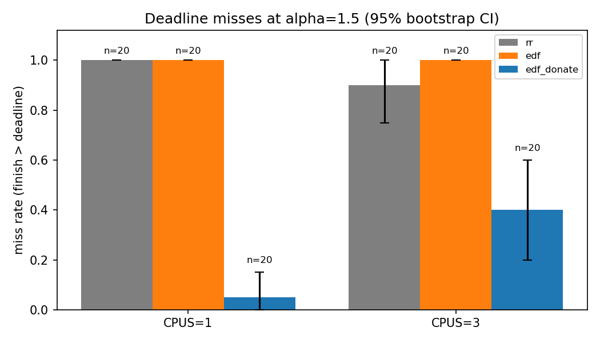
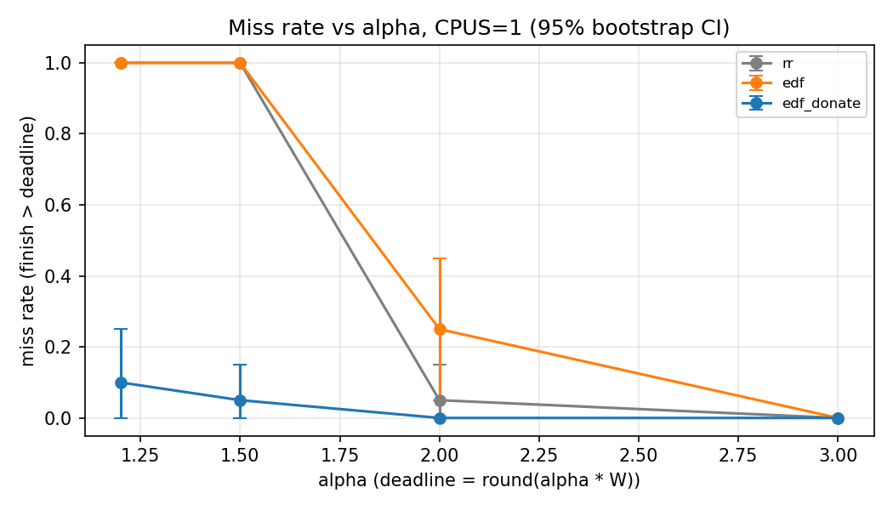

# KernelKraft

**Deadline scheduler with priority donation through pipes, on xv6.**

CSL3030 Operating Systems Lab, IIT Jodhpur. Team KernelKraft: Atharv Dhuvad
(B24CS1085), Ridham Shah (B24CS1064), Pranav H Nair (B24CS1056).

The project replaces the xv6 round-robin scheduler with earliest-deadline-first
(EDF) and removes the priority inversion that EDF suffers on pipelines: when a
process with a deadline sleeps on an empty pipe, it lends its deadline to the
process that will fill that pipe.

The submitted report is [`docs/report/report.pdf`](docs/report/report.pdf).

## Contents

1. [The problem](#the-problem)
2. [How it works](#how-it-works)
3. [Results](#results)
4. [Repository layout](#repository-layout)
5. [Requirements](#requirements)
6. [Build and run](#build-and-run)
7. [Using the scheduler inside xv6](#using-the-scheduler-inside-xv6)
8. [System calls](#system-calls)
9. [Parameters](#parameters)
10. [Tests](#tests)
11. [Reproducing the measurements](#reproducing-the-measurements)
12. [Host agent](#host-agent)
13. [Debugging with GDB](#debugging-with-gdb)
14. [Known limitations](#known-limitations)
15. [Documentation index](#documentation-index)

## The problem

A pipeline is only as fast as its slowest stage. Suppose the last stage has a
deadline and the stages feeding it do not:

```
stage 1 ──pipe──▶ stage 2 ──pipe──▶ stage 3 ──pipe──▶ stage 4     CPU hog
 no deadline       no deadline       no deadline       deadline d   no deadline
```

Under plain EDF, stage 4 is the most urgent process, but it spends its time
asleep waiting for data. Stages 1 to 3 have no deadline, so the scheduler
treats them exactly like the hog. The urgent work waits behind unrelated work.
That is priority inversion.

## How it works

**Workflows.** `setworkflow(wid, D)` puts the calling process in workflow
`wid`. The first caller fixes the workflow's absolute deadline at `now + D`
ticks; later callers join and share it; children inherit it across `fork`.
A process outside any workflow has deadline infinity.

**Effective deadline.** Each process has two fields, its own deadline and a
donated deadline. The scheduler orders runnable processes by

```
effective(p) = min(own(p), donated(p))
```

and runs the smallest. Deadlines are compared with a signed difference, so the
order survives tick-counter wrap-around. Ties go to the process that ran least
recently.

**Donation.** Just before `piperead` puts a process to sleep on an empty pipe,
the kernel lowers the donated deadline of the pipe's writer to the reader's
effective deadline. If that writer is itself asleep on another pipe, the
deadline continues to that pipe's writer, and so on:

```
stage 1 ◀──lend d── stage 2 ◀──lend d── stage 3 ◀──lend d── stage 4 (asleep)
```

| Aspect | Design |
|---|---|
| Who receives | `struct pipe` records its writer (the last process that wrote). If it still holds the write end, it alone receives the donation. Before the first write, every holder of the write end does. |
| Chains | Iterative depth-first walk with an explicit stack bounded by `NPROC`. |
| Cycles | Processes on the current path are marked. Reaching a marked one is a pipe cycle: the kernel prints `donate: cycle` and does not follow the edge. |
| Withdrawal | When a reader wakes, exits or is killed, every donated field is cleared and rebuilt from the readers still asleep. Two donors to one writer need no bookkeeping. |
| Fork | If a child inherits the write end of a pipe an urgent reader is already asleep on, it receives the donation at `fork`. |
| Firm deadlines | After a process misses, its own deadline no longer counts, so late work cannot starve work that can still finish. |
| Admission | A new workflow with less than `MIN_SLACK` ticks of slack is refused. |
| Locking | Everything runs under `ptable.lock`, always taken after the pipe's lock. Printing is deferred until the lock is released. |

The kernel boots in EDF with donation. Round-robin and plain EDF stay
selectable at run time so all three can be measured on one kernel.

Full detail: [`docs/DESIGN.md`](docs/DESIGN.md).

## Results

A 4-stage pipeline moving 2048 bytes competes with CPU hogs (3 hogs on one
CPU, 8 on three). The deadline is `round(alpha * W)`, where `W = 48.2` ticks is
the pipeline's unloaded completion time. Each cell is 20 fresh QEMU boots;
all 480 runs are from kernel commit `d4cb4e4c`.

Deadline misses out of 20:

| alpha | Deadline | RR | EDF | EDF + donation | | RR | EDF | EDF + donation |
|---|---|---|---|---|---|---|---|---|
| | | **1 CPU** | | | | **3 CPUs** | | |
| 1.2 | 58 | 20 | 20 | **2** | | 20 | 20 | **10** |
| 1.5 | 72 | 20 | 20 | **1** | | 18 | 20 | **8** |
| 2.0 | 96 | 1 | 5 | **0** | | 2 | 0 | **0** |
| 3.0 | 145 | 0 | 0 | **0** | | 0 | 0 | **0** |
| Mean finish (ticks) | | 96.7 | 96.3 | **55.9** | | 84.7 | 81.2 | **67.6** |

- Plain EDF is no better than round-robin: the only process with a deadline
  is asleep, so EDF has nothing urgent to run.
- With donation on one CPU the pipeline finishes in about 56 ticks against
  about 96.
- On three CPUs the gain is smaller. A donation lasts only while the reader
  is asleep, and with several CPUs the reader often runs alongside its writer.




Full tables, method and plots: [`results/README.md`](results/README.md). Raw data:
[`results/results.csv`](results/results.csv), one QEMU log per run in
`logs/run_20261111/`.

## Repository layout

```
kernelkraft/
├── xv6-public/          xv6 (x86) kernel and user programs
│   ├── proc.c           scheduler, workflows, donation, trace ring
│   ├── pipe.c           pipe wait hooks, recorded writer
│   ├── sysproc.c        system call wrappers
│   ├── sched_params.h   every tunable parameter, in one place
│   ├── sched_api.h      structs shared by kernel and user code
│   └── wfgen.c, donate5.c, cycletest.c, killtest.c, wftest.c, ...
├── host/                host-side agent
│   ├── bridge/          QEMU serial-console bridge
│   ├── planners/        deterministic, adaptive, and an untested Ollama stub
│   ├── validator.py     checks every tool call before it reaches xv6
│   ├── tools.py         the tool registry
│   ├── plots/           result plots and Gantt charts
│   ├── demos/           injected-instruction demo
│   └── tests/           pytest suite
├── harness/             run_all.py (batch runner), analyze.py (statistics)
├── results/             all results: final CSV, summary, plots, write-up; archive/ holds earlier batches
├── logs/                raw QEMU logs for every test and run
├── docs/                design, results, limitations, test table, journal, report
└── tools/               submission check, packaging, evidence index
```

## Requirements

Tested on Ubuntu with:

- `gcc` with 32-bit support (`gcc-multilib`), `make`, `binutils`
- `qemu-system-i386` (QEMU 8.2 and 10.1 both work)
- `gdb` for the debugging sessions
- Python 3 with `pexpect`, `matplotlib`, `scipy` and `pytest` for the host
  side

```sh
sudo apt install build-essential gcc-multilib qemu-system-x86 gdb python3-pip
pip install pexpect matplotlib scipy pytest
```

## Build and run

```sh
cd xv6-public
make
make qemu-nox CPUS=1
```

For three CPUs, QEMU needs an older machine type; on the default one xv6
starts only CPU 0 (see L-24 in `docs/LIMITATIONS.md`):

```sh
make qemu-nox CPUS=3 QEMUEXTRA="-machine pc-i440fx-yakkety"
```

Leave QEMU with `Ctrl-A` then `X`. Run `make clean` after changing `FSSIZE` or
the list of user programs.

## Using the scheduler inside xv6

| Command | What it does |
|---|---|
| `schedctl rr` / `edf` / `edf_donate` | Select the policy (the kernel boots in `edf_donate`) |
| `schedstat` | Print policy, CPU count, ticks, and counters for misses, donations, cycles, rejected admissions |
| `tracectl 3` / `tracectl 4` | Turn the donation print mode on / off |
| `wfgen <stages> <work> <bytes> <deadline> <hogs>` | Run a pipeline in which only the last stage has a deadline, next to CPU hogs |
| `schedtrace` | Dump the scheduler trace ring (input for the Gantt plot) |
| `calib [iterations]` | Time a fixed busy loop in ticks |

Example, a 4-stage pipeline with a 72-tick deadline against 3 hogs (typical output; finish times vary by a few ticks between runs):

```
$ schedctl edf
$ wfgen 4 100 2048 72 3
RESULT policy=1 cpus=1 finish=93 deadline=72 miss=1
$ schedctl edf_donate
$ wfgen 4 100 2048 72 3
RESULT policy=2 cpus=1 finish=53 deadline=72 miss=0
```

With `tracectl 3`, each donation is printed as it happens:

```
donate: donor=19 recv=18 dl=725
donate: donor=18 recv=17 dl=725
```

`wfgen` accepts 2 to 6 stages and up to 8 hogs. `bytes` should be at least
2048 (four times the pipe buffer) so that the stages really block.

## System calls

| No. | Call | Purpose |
|---:|---|---|
| 22 | `int hello(void)` | Stage 1 checkpoint |
| 23 | `int add(int a, int b)` | Stage 1 checkpoint |
| 24 | `int setsched(int policy)` | 0 = RR, 1 = EDF, 2 = EDF with donation |
| 25 | `int setworkflow(int wid, int deadline)` | Join workflow `wid`; the first caller sets the deadline `deadline` ticks from now |
| 26 | `int schedinfo(struct sched_stats *)` | Policy and counters |
| 27 | `int tracectl(int command)` | Trace ring and donation print mode |
| 28 | `int procinfo(int pid, struct procstat *)` | A process's state, own and donated deadline |
| 29 | `int schedtrace(struct trace_ent *, int max)` | Copy out trace entries |

Exact semantics and error cases: [`docs/SYSCALLS.md`](docs/SYSCALLS.md).

## Parameters

All kernel parameters live in `xv6-public/sched_params.h`; the host reads the
matching values from `host/config.json`.

| Parameter | Value | Meaning |
|---|---|---|
| `DEFAULT_POLICY` | 2 | Policy at boot |
| `MIN_SLACK` | 20 | Minimum relative deadline, in ticks, for a new workflow |
| `MAX_URGENT` | 64 | Cap on processes with their own deadline (equal to `NPROC`) |
| `NWF` | 16 | Workflows alive at once; any positive `wid` is valid |
| `TRACE_SIZE` | 256 | Entries per trace ring |
| `MAX_HOGS` | 8 | Upper bound on `wfgen` hogs |
| `MIN_STAGES` / `MAX_STAGES` | 2 / 6 | `wfgen` pipeline length |
| `W_ticks` (host) | 48.2 | Calibrated unloaded completion time |
| `alpha_values` (host) | 1.2, 1.5, 2.0, 3.0 | Deadline multipliers for the sweep |
| `hogs_by_cpus` (host) | 3 / 8 | Hogs on 1 CPU / 3 CPUs |

History and calibration runs: [`docs/PARAMS.md`](docs/PARAMS.md).

## Tests

Run these inside xv6. Each ends with `RESULT <name>` on success.

| Program | Checks |
|---|---|
| `donate5` | 5-stage chain against a hog: the deadline hops back across all four pipes |
| `donatetest` | 4-stage chain where only the final reader has a deadline |
| `cycletest` | Two processes in a pipe cycle: `donate: cycle` is reported and the kernel keeps running |
| `killtest` | Two donors killed in turn: the receiver keeps the deadline after the first kill and loses it after the second |
| `wftest` | `setworkflow`: a refused admission leaves no slot behind, a later joiner shares the deadline, a large wid is accepted, a workflow survives its creator |
| `test_negative` | Invalid arguments are refused |
| `edftest` | EDF ordering of processes with different deadlines |
| `smallpipe` | A single write smaller than the pipe buffer still reaches the reader |
| `usertests` | The stock xv6 regression suite |

Host-side tests:

```sh
python3 -m pytest host/tests
```

Every test, its expected and observed result, and the log that proves it:
[`docs/TEST_TABLE.md`](docs/TEST_TABLE.md).

## Reproducing the measurements

The harness boots a fresh QEMU for every run, selects the policy, runs
`wfgen`, and appends one row with the kernel commit hash and the path of the
raw log. It refuses to run on a modified working tree.

```sh
# 24-run check (2 runs per cell)
python3 harness/run_all.py --dry-run --alphas 1.5,2.0 --cpus 1,3 \
    --output results/dryrun.csv --rawlog-dir logs/dryrun

# full sweep: 4 alphas x 3 policies x 2 CPU counts x 20 runs = 480 runs
python3 harness/run_all.py --alphas 1.2,1.5,2.0,3.0 --cpus 1,3 --runs 20 \
    --output results/results.csv --rawlog-dir logs/run_$(date +%Y%m%d)

python3 harness/analyze.py
python3 host/plots/plot_results.py results/summary.csv results/results.csv
python3 tools/index_evidence.py --index docs/EVIDENCE_INDEX.md
```

`analyze.py` writes `results/summary.csv` and `results/summary.md` with miss
counts, bootstrap intervals and Fisher's exact test. A run takes about one
second, so the full sweep finishes in roughly ten minutes.

## Host agent

The host side models the setting the course is about: an agent issues tool
calls, a user program carries them out, and the kernel is the last layer that
can refuse.

```
request ──▶ planner ──▶ validator ──▶ QEMU bridge ──▶ xv6 user program ──▶ kernel
                           │                                                  │
                    refuses bad calls                              refuses bad workflows
```

- **Tools:** `list_files`, `read_file`, `set_policy`, `run_pipeline`,
  `sched_stats`, `summarize`.
- **Validator:** checks tool names, argument types and ranges, and the file
  allowlist before anything reaches xv6.
- **Bridge:** drives the xv6 console over the QEMU serial port and frames each
  command with a random nonce, so echoed input cannot fake completion.
- **Audit log:** every action is recorded in `logs/audit.jsonl`.

Planners:

| Planner | Behaviour | Status |
|---|---|---|
| `deterministic` (default) | Fixed rules; `--mode injected` follows an instruction hidden in a file | Working |
| `adaptive` | Runs under RR, switches to EDF with donation if the deadline is missed, compares | Working |
| `ollama` | Asks a local Llama 3 model for a tool call | Stub, never run |

```sh
python3 host/agent.py "list files and read /report.txt"
python3 host/agent.py "run the pipeline" --planner adaptive --alpha 1.5
python3 host/demos/injection_demo.py
```

In the injection demo the hostile request asks for a 1-tick deadline and
8 hogs. The validator blocks it, and when the same command is typed straight
into the xv6 shell the kernel refuses it with `admit: rejected ... reason=slack`.

## Debugging with GDB

```sh
# terminal 1
cd xv6-public && make qemu-nox-gdb CPUS=1
# terminal 2
cd xv6-public && gdb kernel
(gdb) break sys_setworkflow_impl
(gdb) continue
```

If gdb declines to load `.gdbinit`, either type `source .gdbinit` once or add
the path to `~/.config/gdb/gdbinit` as gdb suggests.

`docs/gdb/slot-leak-before.txt` and `docs/gdb/slot-leak-after.txt` record a
real bug found this way: a refused `setworkflow` left its table slot marked in
use with zero members, so every later request for that workflow failed.

## Known limitations

The complete list is [`docs/LIMITATIONS.md`](docs/LIMITATIONS.md). The main
ones:

- A donation lasts only while the reader is asleep, so the benefit is smaller
  on several CPUs.
- Recomputing donations is quadratic in the number of processes. This is fine
  for the 64 processes xv6 allows.
- Before a pipe's first write, every holder of the write end receives the
  donation, including a process that merely kept a descriptor open.
- A process can join one workflow and cannot leave it.
- The project uses the x86 `xv6-public` tree given in the course setup, not
  `xv6-riscv`.
- One `usertests` run hung in `concreate` (L-28); it was not reproduced and
  the cause is open.

## Documentation index

| File | Contents |
|---|---|
| [`docs/report/report.pdf`](docs/report/report.pdf) | Submitted project report |
| [`docs/DESIGN.md`](docs/DESIGN.md) | Design of the scheduler, workflows, donation, tracing and host agent |
| [`results/README.md`](results/README.md) | Final measurement results, with everything else under `results/` |
| [`docs/SYSCALLS.md`](docs/SYSCALLS.md) | System call reference |
| [`docs/PARAMS.md`](docs/PARAMS.md) | Parameters and calibration history |
| [`docs/LIMITATIONS.md`](docs/LIMITATIONS.md) | Known limitations, with status |
| [`docs/TEST_TABLE.md`](docs/TEST_TABLE.md) | Every test with expected result, observed result and evidence |
| [`docs/EVIDENCE_INDEX.md`](docs/EVIDENCE_INDEX.md) | Map from evidence files to tests |
| [`docs/JOURNAL.md`](docs/JOURNAL.md) | Design journal: what failed and why |
| [`docs/CONTRIBUTIONS.md`](docs/CONTRIBUTIONS.md) | What each team member did |
| [`docs/CHANGES_2026-11-11.md`](docs/CHANGES_2026-11-11.md) | The final round of kernel fixes |
| [`docs/predictions.md`](docs/predictions.md) | Predictions committed before measuring |
| [`docs/PLAN.md`](docs/PLAN.md) | Original staged plan |
| [`results/archive/`](results/archive/) | Earlier batches (historical) |

xv6 is distributed under the MIT licence; see `xv6-public/LICENSE`.
