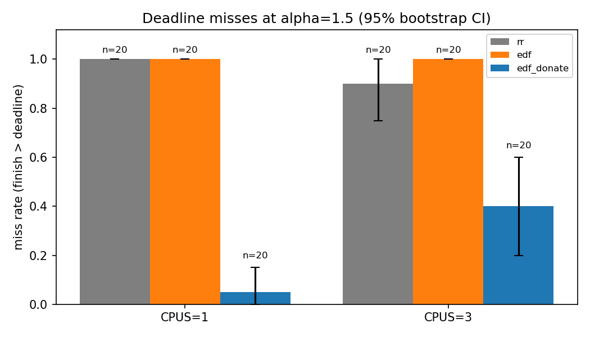
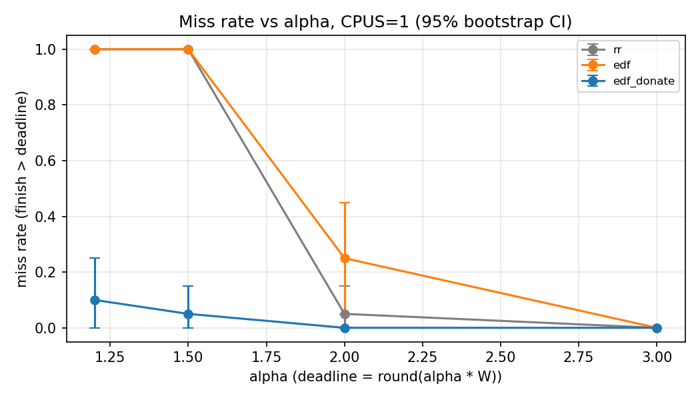
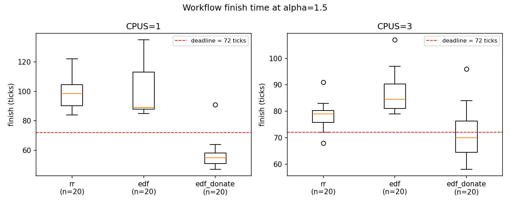

# Results

Final measurement batch, 2026-11-11. This supersedes the batch of 6 November
described in [`archive/batch2_20261106/README.md`](archive/batch2_20261106/README.md).

## Setup

| Item | Value |
|---|---|
| Kernel commit | `d4cb4e4c` (every row of the CSV carries it) |
| Workload | `wfgen 4 100 2048 <deadline> <hogs>`: 4 stages, 2048 bytes, only the last stage has a deadline |
| Unloaded completion time `W` | 48.2 ticks (CPUS=1, no hogs; `logs/stage7rev-calibration/`) |
| Deadline | `round(alpha * W)` for alpha = 1.2, 1.5, 2.0, 3.0, giving 58, 72, 96, 145 ticks |
| Load | 3 hogs on CPUS=1, 8 hogs on CPUS=3 |
| Policies | `rr`, `edf`, `edf_donate` |
| Runs | 20 per cell, each a fresh QEMU boot with `-snapshot`; 480 in total, all with status `ok` |
| QEMU | `-machine pc-i440fx-yakkety` so that xv6 starts all three CPUs |
| Miss rule | `finish > deadline`, computed by `wfgen` and rechecked by `harness/analyze.py` |

`W` was calibrated on one CPU before the final kernel changes and is used for
both CPU counts.

## Deadline misses out of 20

| CPUs | alpha | Deadline | rr | edf | edf_donate |
|---|---|---|---|---|---|
| 1 | 1.2 | 58 | 20 | 20 | 2 |
| 1 | 1.5 | 72 | 20 | 20 | 1 |
| 1 | 2.0 | 96 | 1 | 5 | 0 |
| 1 | 3.0 | 145 | 0 | 0 | 0 |
| 3 | 1.2 | 58 | 20 | 20 | 10 |
| 3 | 1.5 | 72 | 18 | 20 | 8 |
| 3 | 2.0 | 96 | 2 | 0 | 0 |
| 3 | 3.0 | 145 | 0 | 0 | 0 |

## Completion time in ticks

Mean (standard deviation) over 20 runs.

| CPUs | alpha | rr | edf | edf_donate |
|---|---|---|---|---|
| 1 | 1.2 | 91.6 (5.5) | 97.2 (7.0) | 56.2 (3.7) |
| 1 | 1.5 | 98.4 (10.7) | 99.0 (14.7) | 56.5 (9.5) |
| 1 | 2.0 | 91.2 (4.1) | 91.2 (8.2) | 55.2 (4.8) |
| 1 | 3.0 | 105.5 (6.4) | 97.8 (7.3) | 55.7 (2.0) |
| 3 | 1.2 | 83.5 (12.6) | 78.3 (4.1) | 62.5 (12.3) |
| 3 | 1.5 | 78.5 (4.8) | 86.5 (7.1) | 71.0 (9.3) |
| 3 | 2.0 | 86.8 (6.7) | 75.2 (5.1) | 65.0 (7.1) |
| 3 | 3.0 | 90.2 (5.3) | 84.7 (7.1) | 71.8 (9.0) |

Pooled over all 80 runs of a policy and CPU count:

| CPUs | rr | edf | edf_donate |
|---|---|---|---|
| 1 | 96.7 | 96.3 | 55.9 |
| 3 | 84.7 | 81.2 | 67.6 |

## Significance

Fisher's exact test, `edf` against `edf_donate`, at alpha = 1.5 (from
`results/summary.md`):

| CPUs | edf missed / met | edf_donate missed / met | p (two-sided) |
|---|---|---|---|
| 1 | 20 / 0 | 1 / 19 | 3.0e-10 |
| 3 | 20 / 0 | 8 / 12 | 4.5e-05 |

## Reading the results

- **Plain EDF does not help.** Its miss counts and completion times match
  round-robin. The only process with a deadline is asleep on a pipe, so EDF
  has nothing urgent to run and the earlier stages share the CPU with the
  hogs.
- **Donation removes the inversion on one CPU.** The pipeline finishes in
  about 56 ticks, not far above its unloaded 48, against about 96 for the
  other two policies.
- **On three CPUs the gain is smaller.** Donation never misses more often
  than either baseline, but it still misses 8 to 10 of 20 at the two tight
  deadlines. A donation lasts only while the reader is asleep. With three
  CPUs the reader often runs at the same time as its writer, and each time it
  wakes the writer drops back to competing with the hogs.
- **Loose deadlines hide the difference.** At alpha = 3.0 no policy misses.
- At alpha = 1.5 on one CPU, one `edf_donate` run finished at 91 ticks
  against a typical 55. This is consistent with firm deadlines: once a
  process misses, its own deadline stops counting, so a run that slips past
  the deadline finishes much later than one that just makes it. The trace of
  that run was not examined.

## Everything in this directory

| Path | Contents |
|---|---|
| `results.csv` | Final batch, one row per run: policy, cpus, run, alpha, finish, deadline, miss, status, commit hash, raw log path |
| `summary.csv`, `summary.md` | Per-cell statistics, bootstrap intervals, Fisher's exact test |
| `*.png`, `*.sources.txt` | Plots of the final batch and the data each was drawn from |
| `archive/batch2_20261106/` | Batch of 2026-11-06: 210 runs, 5 hogs on CPUS=3, earlier kernel; with its write-up, pilot run and Gantt charts |
| `archive/batch1_20261104/` | Batch of 2026-11-04, set aside: 1024-byte payload, below four times the pipe buffer, and other departures from the plan (see its README) |
| `archive/stage6_20261103/` | Stage 6 harness dry run and the first Gantt chart |
| `archive/stage8-dry-run_20261107.csv` | Stage 8 harness dry run |

The raw QEMU log of every run stays under `logs/` (the final batch is
`logs/run_20261111/`), because each CSV row records its log by that path.

Reproduce with the commands under "Reproducing the measurements" in the
[top-level README](../README.md).
